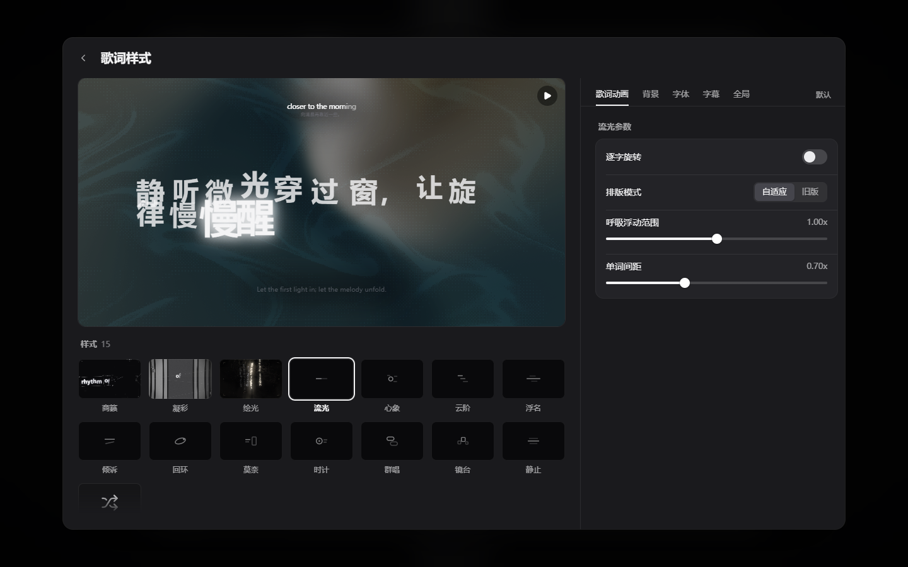
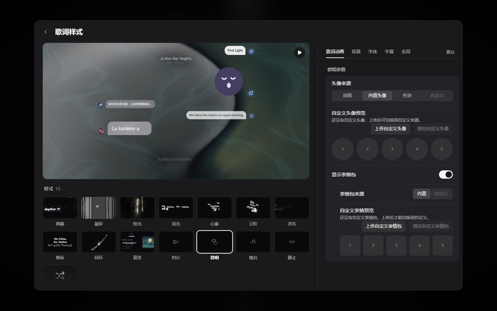

<p align="center">
  
</p>

<div align="center">

# Folia Plain

Immersive Lyrics, Simply Music // 歌词入境，听歌归简

[简体中文](README.md) | [English](README.en.md)

[](https://github.com/ithtelab/Folia-Plain/actions/workflows/ci.yml)
[](LICENSE)
[](https://nodejs.org/)
[](package.json)
[](https://github.com/ithtelab/Folia-Plain/stargazers)

[获取方式](#获取方式) · [本地运行](#本地运行) · [部署说明](#部署) · [开发与维护](docs/plain.md)

</div>

## 项目简介

**Folia Plain** 是一个以沉浸式歌词和动态排版为核心的音乐播放器，基于 [Folia / folia-major](https://github.com/chthollyphile/folia-major) 独立维护。

保留上游丰富的歌词动效、音乐平台接入、本地曲库和主题能力，将默认视觉整理为抽象图形、几何头像与中性文案。没有内置角色立绘、拟人头像或设置页图片彩蛋，让音乐、歌词和你选择的封面成为界面的重点。

提供基于 React / Vite 的 Web 版本与基于 Electron 的 Windows、macOS、Linux 桌面构建方式。

> 本项目的上游是 **chthollyphile/folia-major 音乐播放器**，与 Minecraft 服务端 **PaperMC/Folia** 无关。

## Plain 做了什么

| 内容 | 调整 |
| --- | --- |
| 群唱头像与表情 | 替换为几何图案和简洁反应符号；保留自定义导入。 |
| 预览封面与歌词 | 换成抽象封面与原创中性示例，保留逐字、翻译和背景和声演示。 |
| 界面文案 | 使用清晰的操作与加载提示，移除图片彩蛋。 |
| 项目身份 | 统一为 Folia Plain，反馈和更新指向本仓库，桌面数据目录独立。 |
| 首页与文档 | 去掉角色宣传素材，使用简洁排版与本分支的获取说明。 |
| 构建流程 | 提供自动检查和手动桌面构建，不继承上游定时发版与社区机器人。 |

在线曲库中的音乐分类、日文歌词、用户自己的封面和头像都可正常使用。Plain 整理的是应用自带内容，不限制你的音乐选择。

## 展示



<p align="center">原创示例 · 抽象封面 · 沉浸式歌词</p>



## 核心能力

| 模块 | 说明 |
| --- | --- |
| 歌词与排版 | 多种全屏歌词样式，支持逐字歌词、翻译、音译和背景和声。 |
| 音乐平台 | 网易云、QQ 音乐、酷狗；桌面端还保留波点、YouTube Music 与 Spotify 接入。各平台需按要求配置或登录。 |
| 本地与自托管曲库 | 导入本地音乐，连接 Navidrome / Subsonic；可自动匹配歌词与封面。 |
| 歌词文件 | 保留 LRC、VTT、TTML、QRC、YRC、KRC 与 Folia 歌词格式支持。 |
| 外观与主题 | 封面配色、背景与字体调整，可选 AI 主题生成。 |
| 桌面集成 | 保留桌面歌词、Now Playing、OBS、快捷键等上游能力，依平台与配置而定。 |
| 扩展与同步 | 保留实验性 Folium 模组及可自行托管的 Sync Server。 |

## 获取方式

- **源码**：克隆本仓库后本地运行，步骤见下文。
- **Web 构建产物**：检查通过后，可在 [Checks](https://github.com/ithtelab/Folia-Plain/actions/workflows/ci.yml) 的运行页面下载 `folia-plain-web`。
- **桌面构建**：维护者可手动运行 [Build desktop](https://github.com/ithtelab/Folia-Plain/actions/workflows/desktop-build.yml)，从运行页面下载对应平台的构建产物。
- **Windows 下载**：[本仓库 Releases](https://github.com/ithtelab/Folia-Plain/releases/latest) 提供 x64 `.exe` 安装包与免安装 ZIP；完整解压 ZIP 后运行 `Folia Plain.exe`。同时提供 SHA-256 校验值。macOS 与 Linux 可使用上述桌面构建流程。

上游的安装包、网盘和 AUR 包仍是原版，不能用来安装 Folia Plain。

## 本地运行

需要 **Node.js 24+**。

```sh
git clone https://github.com/ithtelab/Folia-Plain.git
cd Folia-Plain
npm ci
cp .env.example .env.local
npm run dev -- --host 127.0.0.1
```

Windows PowerShell 可用 `Copy-Item .env.example .env.local` 代替复制命令。打开终端输出的地址即可。

界面、歌词样式预览和本地音乐导入可先直接体验。在线平台需要配置相应后端或账户；AI 主题需要自行配置服务密钥。`npm run dev` 只启动前端，桌面开发可使用 `npm run dev:electron`。

```sh
npm run typecheck
npm run test:unit
npm run build
npm run preview -- --host 127.0.0.1
```

## 部署

[](https://vercel.com/new/clone?repository-url=https://github.com/ithtelab/Folia-Plain)

Vercel 选择 Node.js 24+，构建命令为 `npm run build`，静态输出目录为 `dist`。参照[环境变量模板](.env.example)按需配置音乐接口与 AI 服务。

QQ 音乐的 serverless 入口、Cloudflare 与 Docker 的平台差异可参考 [QQ 音乐部署说明](docs/qq-music-deployment.md) 和 [Docker 说明](deploy/docker/README.md)。本分支暂未发布容器镜像，Docker 需要从源码构建。

桌面打包需要平台编译工具和原生依赖，详见[开发与维护](docs/plain.md)。跨设备同步可以自行部署 [`sync-server`](sync-server/README.md)，再在设置中填写服务地址与令牌。

## 文档与开发

- [本分支说明、开发、打包与更新上游](docs/plain.md)
- [上游 PR 筛选与移植记录](docs/upstream-prs.md)
- [技术与开发说明](docs/technical.md)（继承上游，下载和发版信息以本分支说明为准）
- [本地音乐库管理](docs/local-library-management.md)
- [模组开发指南](docs/folium/contributing.md) · [API 参考](docs/folium/api.md)
- [问题反馈](https://github.com/ithtelab/Folia-Plain/issues)

## 来源与致谢

感谢 [chthollyphile/folia-major](https://github.com/chthollyphile/folia-major) 的作者与[贡献者](CONTRIBUTORS.md)。本分支从上游 **0.7.21**（`f3a9070`）开始，保留原始 Git 历史、代码版权声明和贡献记录。原版 README 存档见 [docs/upstream](docs/upstream/README.md)。

同时感谢上游使用的开源项目，包括 [LDDC](https://github.com/chenmozhijin/LDDC)、[AMLL TTML 歌词库](https://github.com/amll-dev/amll-ttml-db)、[网易云音乐 API](https://github.com/NeteaseCloudMusicApiEnhanced/api-enhanced)、[QQ 音乐 API](https://github.com/yakult-green-tea/qq-music-api)、[酷狗音乐 API](https://github.com/MakcRe/KuGouMusicApi)、[Pretext](https://github.com/chenglou/pretext) 和 [Paper Shaders](https://github.com/paper-design/shaders)。

## 许可证

继续使用 [AGPL-3.0](LICENSE)。本分支新增的矢量素材使用同一许可证。音乐、歌词、专辑封面及外部服务内容的权利归对应权利人所有，请遵守相关服务的使用条款并支持正版音乐。
